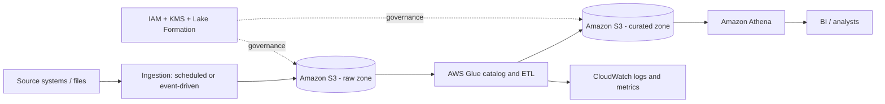

# DataForge — Reference Architecture

## Purpose

This document describes a proposed AWS lakehouse for ingesting structured and semi-structured source data, retaining raw history, producing curated datasets, and exposing governed SQL analytics.

**Status:** Architecture case study / documentation. This is not a deployed AWS environment. No claim is made that the author provisioned or operated these services.

## High-level flow

## Storage zones

| Zone | Purpose | Example layout |
|---|---|---|
| Raw / bronze | Immutable landing copy, minimal transformation | `s3://<bucket>/raw/<source>/<ingest_date>/` |
| Standardised / silver | Validated schema, normalised types, deduplication | `s3://<bucket>/silver/<domain>/` |
| Curated / gold | Business-ready aggregates and dimensional models | `s3://<bucket>/gold/<domain>/<table>/` |

Prefer columnar Parquet for analytical datasets. Partition by query-relevant, reasonably bounded fields such as event date; avoid high-cardinality partition keys.

## Service responsibilities

- **Amazon S3:** durable object storage and zone separation.
- **AWS Glue Data Catalog:** central table and schema metadata.
- **AWS Glue ETL:** managed transformation jobs where Spark-scale processing is justified.
- **Amazon Athena:** serverless SQL over curated S3 data.
- **AWS IAM / KMS:** least-privilege access and encryption-key management.
- **AWS Lake Formation:** centralised fine-grained data permissions where adopted.
- **Amazon CloudWatch:** operational logs, metrics, and alarms.
- **Amazon EventBridge:** scheduled or event routing for ingestion orchestration.

Service selection is a design proposal. Actual choices should be validated against data volume, latency, skills, region, and cost.

## Data quality controls

1. Validate required columns and data types at ingestion.
2. Quarantine malformed records rather than silently dropping them.
3. Track row counts, null rates, duplicate rates, and freshness.
4. Make ingestion idempotent using source identifiers and ingestion metadata.
5. Preserve raw source data to support replay and audit.
6. Version schemas and document breaking changes.

## Security and governance

- Separate development and production accounts/environments.
- Block public S3 access and apply bucket policies.
- Encrypt data at rest with SSE-KMS where required and use TLS in transit.
- Use narrowly scoped IAM roles for each workload.
- Keep credentials out of source control; prefer IAM roles and a secrets manager.
- Apply data classification, retention, and deletion rules.
- Mask or tokenise sensitive fields before broad analytics access.
- Log administrative and data-access events according to organisational policy.

## Operational considerations

Monitor ingestion success, job duration, bytes processed, failed records, data freshness, and Athena scanned bytes. Define alert thresholds based on service-level objectives. Include retry limits and dead-letter/quarantine handling to prevent poison-message loops.

## Cost considerations

The major cost drivers are S3 storage and requests, Glue compute/runtime, Athena data scanned, CloudWatch ingestion/retention, and data transfer. Use Parquet, compression, partition pruning, lifecycle policies, and workload schedules to control spend. No dollar estimate is included because region, volume, retention, and usage assumptions have not been specified.

## Open questions before implementation

- What are the source systems, formats, and ingestion SLAs?
- What are daily volume and growth expectations?
- Which data domains contain personal or regulated information?
- What are retention, residency, and deletion obligations?
- Which consumers require batch, interactive SQL, or low-latency access?
- What is the budget and target AWS region?
